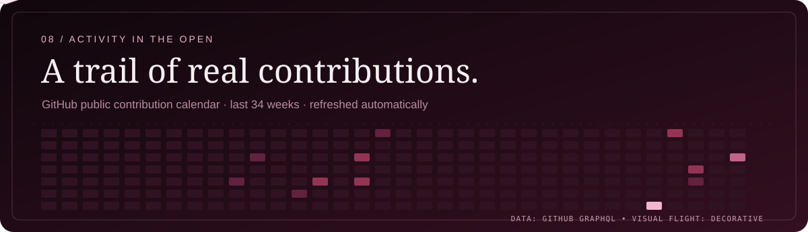

<!-- SAI CHARITHARTH NADIGOTI — original editorial SVG identity / animated GitHub README -->

**FULL-STACK DEVELOPMENT** &nbsp; · &nbsp; **AI AGENT SECURITY** &nbsp; · &nbsp; **SOFTWARE ENGINEERING**

<a href="https://github.com/Bunny100806?tab=repositories">PROJECTS</a> &nbsp; / &nbsp;
<a href="https://www.linkedin.com/in/sai-charitharth-nadigoti-8764802bb/">LINKEDIN</a> &nbsp; / &nbsp;
<a href="https://www.kaggle.com/saicharitharthn">KAGGLE</a> &nbsp; / &nbsp;
<a href="https://github.com/Eman0989/aegistwin">AEGISTWIN</a>

I’m **Sai Charitharth Nadigoti**, a **Computer Engineering student at Vistula University in Warsaw**. I build full-stack applications and AI-enabled systems, with a focus on **React**, **Python/FastAPI**, software architecture, and AI-agent security.

**HackYeah 2026 — Top 3, Goldman Sachs AI Control Layer challenge.** As part of **Team SEVA**, I helped develop AegisTwin, an AI-agent security control layer.

- **SG Analytics — Web Developer Intern** (October 2025–present). React e-commerce landing pages, interface development and UI design.
- **RamanaSoft — C/C++ Developer Intern** (November 28, 2024–January 29, 2025). C/C++ software development.

A security layer for LLM agents that evaluates actions, enforces policy guardrails, and preserves auditable decisions. My Team SEVA contributions include the **React security console, API integration, guardrails, policy presets and debugging**.

**[EXPLORE AEGISTWIN](https://github.com/Eman0989/aegistwin)**

My independent AI-assisted architecture exploration project, combining **React, FastAPI and Ollama** to turn natural-language requirements into structured designs.

**[EXPLORE ARCHAGENT-R](https://github.com/Bunny100806/ArchAgent-R)**

<b>More engineering projects</b>

- **AutoThreatOps** — multi-agent threat analysis, risk assessment and incident response.
- **PerfMind** — code optimization and runtime/memory measurement.
- **PO-LoRa** — LoRaWAN relay and simulation research.

**[KAGGLE PROFILE](https://www.kaggle.com/saicharitharthn)** — public coding/data-science profile. No unverified rankings or medals are displayed.

The animated contribution graphic is generated from <b>real public GitHub contributions</b> by the included GitHub Actions workflow. Before its first successful run, the grid is explicitly decorative. [See the authoritative GitHub contribution graph](https://github.com/Bunny100806).

[**GITHUB**](https://github.com/Bunny100806) · [**LINKEDIN**](https://www.linkedin.com/in/sai-charitharth-nadigoti-8764802bb/) · [**KAGGLE**](https://www.kaggle.com/saicharitharthn)

