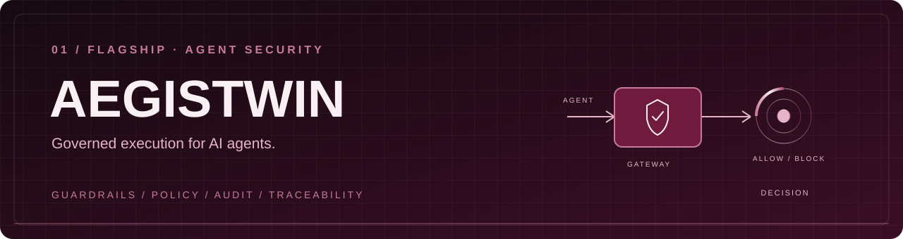
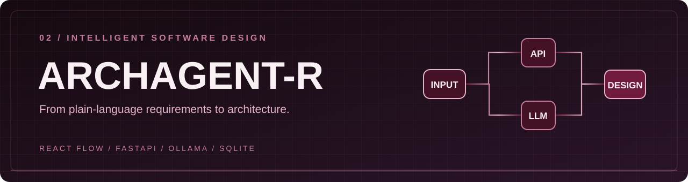
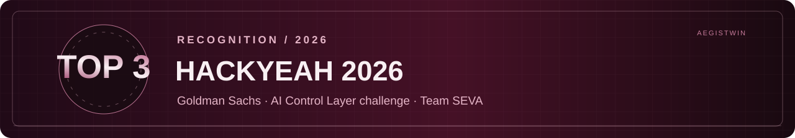

**[EXPLORE MY CODE](https://github.com/Bunny100806?tab=repositories)** · **[LINKEDIN](https://www.linkedin.com/in/sai-charitharth-nadigoti-8764802bb/)** · **[AEGISTWIN](https://github.com/Eman0989/aegistwin)**

**FULL-STACK DEVELOPMENT** / **AI AGENT SECURITY** / **SOFTWARE ARCHITECTURE**

---

## 01 / THE PERSON BEHIND THE CODE

I'm **Sai Charitharth Nadigoti**, a Computer Engineering student at **Vistula University, Warsaw**, and a developer working at the intersection of **full-stack engineering, intelligent systems, and AI security**.

I build interfaces that communicate clearly, backends that hold up under scrutiny, and AI-powered tools that solve practical problems. At **SG Analytics**, I work on the UI and development of React e-commerce landing pages as a **Web Developer Intern** (Oct 2025–present).

> **My approach:** thoughtful architecture, pragmatic implementation, and a user experience that feels intentional.

---

## 02 / SELECTED WORK

### AegisTwin

`AI Security` · `FastAPI` · `React` · `Policy Guardrails` · `PostgreSQL`

An AI-agent security control layer designed to evaluate tool actions, detect suspicious behavior, enforce policy, and produce traceable decisions. I contributed to the **React security console, API integration, guardrails, policy presets, and debugging** as part of **Team SEVA**.

[Explore the AegisTwin team repository](https://github.com/Eman0989/aegistwin)

### ArchAgent-R

`React` · `FastAPI` · `React Flow` · `Ollama` · `SQLite`

A software architecture reasoning application that turns natural-language requirements into structured architecture designs, with an interactive canvas, AI assistant, saved project history, and export workflows.

[Explore ArchAgent-R](https://github.com/Bunny100806/ArchAgent-R)

### Other projects

- **AutoThreatOps** — AI-assisted threat analysis, risk assessment, and incident-response workflows.
- **PerfMind** — code optimization exploration with execution-time and memory measurements.
- **PO-LoRa** — Python-based LoRaWAN relay and simulation work.

---

## 03 / RECOGNITION

**Top 3 — HackYeah 2026, Goldman Sachs AI Control Layer challenge.** Our team, **SEVA**, developed **AegisTwin** to demonstrate governed execution and security control for AI agents.

---

## 04 / TOOLS OF THE TRADE

| Domain | Technologies I use |
| :--- | :--- |
| **Languages** | Python · JavaScript · TypeScript · C · C++ |
| **Frontend** | React · Vite · Tailwind CSS · React Flow |
| **Backend & APIs** | FastAPI · Node.js · Express |
| **AI systems** | Ollama · Llama 3.2 · CrewAI |
| **Data & infrastructure** | PostgreSQL · SQLite · Docker · Git |

**Currently focused on:** robust Python backends, AI-agent security, polished React experiences, and measurable software quality.

---

## 05 / ACTIVITY IN THE OPEN

*This third-party visualization uses GitHub activity data. Visit [my GitHub profile](https://github.com/Bunny100806) for the authoritative contribution graph; no activity totals or streaks are claimed here.*

---

## 06 / CONNECT

Interested in **full-stack engineering**, **AI security**, or **collaborative software projects**?

**[GitHub](https://github.com/Bunny100806)** · **[LinkedIn](https://www.linkedin.com/in/sai-charitharth-nadigoti-8764802bb/)**

